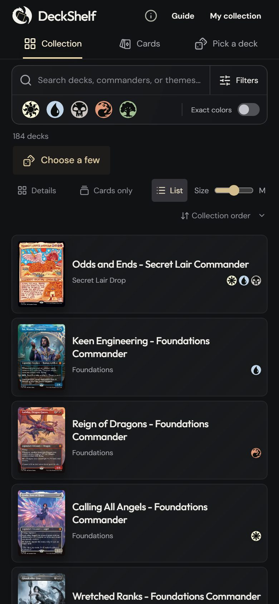

# DeckShelf

A showcase for your Commander decks: browse them as full commander cards, filter
by colour and theme, and let an animated double helix pick tonight's deck.


<p>
  
  
</p>

- **Your decks, from Archidekt.** Link a public account, folder or deck. Imports are read-only and need no password.
- **Starts with every official precon.** A removable demo collection of all Commander precons.
- **Private by default.** Your collection lives in your browser. Back it up to a file and restore it anywhere.
- **Fair picks.** Every eligible deck has an equal chance; filters decide the pool.



## Get started

**Run from source** (Node.js 22.12+):

```sh
npm ci
npm run dev
```

Then open http://127.0.0.1:4317. On Windows you can double-click
`scripts/start-windows.cmd` instead.

**Windows app:** an optional installer is built from each release. See the
[desktop guide](docs/DESKTOP.md).

**Host it yourself:** Docker image and Compose files are in `deploy/`. See
[hosting](docs/HOSTING.md).

## Documentation

- [Using DeckShelf](docs/USAGE.md): views, filters, the picker, sources and backups
- [Development](docs/DEVELOPMENT.md): repository layout, tests and CI
- [Hosting](docs/HOSTING.md) · [Desktop app](docs/DESKTOP.md) · [Releasing](docs/RELEASING.md)
- [Design direction](docs/DESIGN.md) for interface changes

<br clear="right">

## Credits

Unofficial fan project, not affiliated with Wizards of the Coast. Magic: The
Gathering, card names and artwork belong to their owners. Deck data from
[Archidekt](https://archidekt.com/commander-precons); mana symbols from
[Scryfall](https://scryfall.com/docs/api/card-symbols). See
[third-party notices](docs/THIRD_PARTY_NOTICES.md) and the
[licensing status](LICENSE.md).
