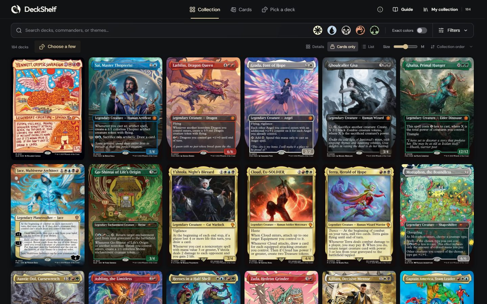
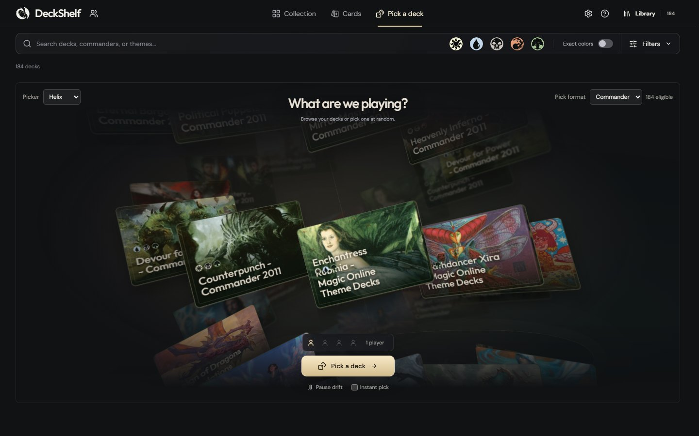
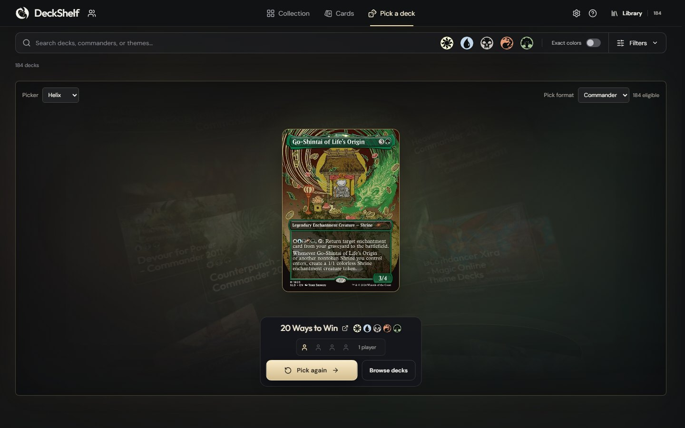
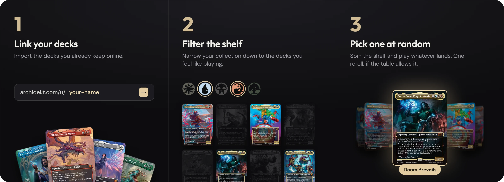

<p align="center">
  
</p>

<h1 align="center">DeckShelf</h1>

<p align="center">
  DeckShelf shows your Magic: The Gathering decks as a wall of cards.<br>
  Filter them, then pick one at random when the table can't decide what to play.
</p>



<p>
  
  
</p>

## What it does

DeckShelf reads public decklists from Archidekt and shows each deck as its
commander or featured card. Search by name, filter by format, colour identity, set or theme, and send
the matching decks to the picker. Every deck in the pool has the same chance.



- Imports public Archidekt accounts, folders and single decks. It only reads them and never asks for a login.
- Ships with the 184 Commander precons from Archidekt's catalog as an optional starter collection, so it works before you link anything.
- Picks with a spinning helix or a shuffle-and-deal, for up to four players at once.
- Opens a friend's public Archidekt collection by username, read-only beside your own. Bookmark it, or send your own shelf as a link.
- Saves your collection in your browser. A backup file moves it to another browser or the Windows app.
- Runs in the browser, in Docker or as a Windows app.

Commander is the default. Choose All formats in the folder list to include Modern,
Standard, Pauper and other Archidekt formats. The picker always uses one explicit
format scope.

## Get started

**Run from source** (Node.js 22.18+):

```sh
npm ci
npm run dev
```

Then open http://127.0.0.1:4317. On Windows you can double-click
`scripts/start-windows.cmd` instead.

**Windows app:** an optional installer is built from each release. See the
[desktop guide](docs/DESKTOP.md).

**Host it yourself:** Docker image and Compose files are in `deploy/`. See
[hosting](docs/HOSTING.md).

## Documentation

- [Using DeckShelf](docs/USAGE.md): views, filters, the picker, sources and backups
- [Development](docs/DEVELOPMENT.md): repository layout, tests and CI
- [Hosting](docs/HOSTING.md) · [Desktop app](docs/DESKTOP.md) · [Releasing](docs/RELEASING.md)
- [Design direction](docs/DESIGN.md) for interface changes · [Decisions](docs/DECISIONS.md) so far

## Credits

Inspired by [GameShelf](https://gameshelf.io/): the same idea, for Magic decks.

DeckShelf is unofficial Fan Content permitted under the
[Fan Content Policy](https://company.wizards.com/en/legal/fancontentpolicy). Not
approved/endorsed by Wizards. Portions of the materials used are property of
Wizards of the Coast. ©Wizards of the Coast LLC. Deck data from
[Archidekt](https://archidekt.com/commander-precons); mana symbols from
[Scryfall](https://scryfall.com/docs/api/card-symbols). See
[third-party notices](docs/THIRD_PARTY_NOTICES.md). The source code is
[MIT licensed](LICENSE.md); card art and other third-party material keep their own terms.
