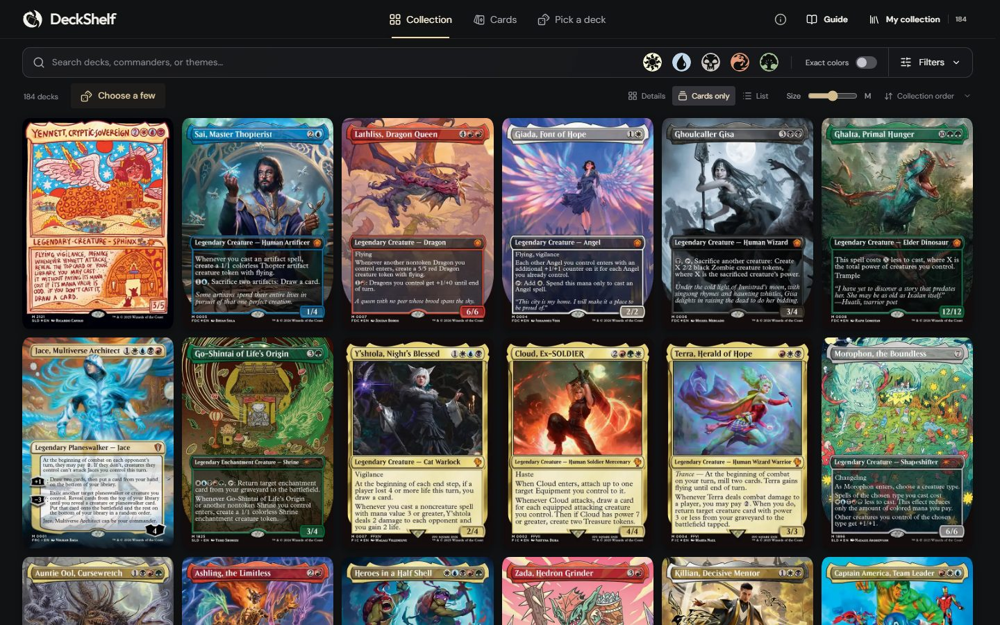
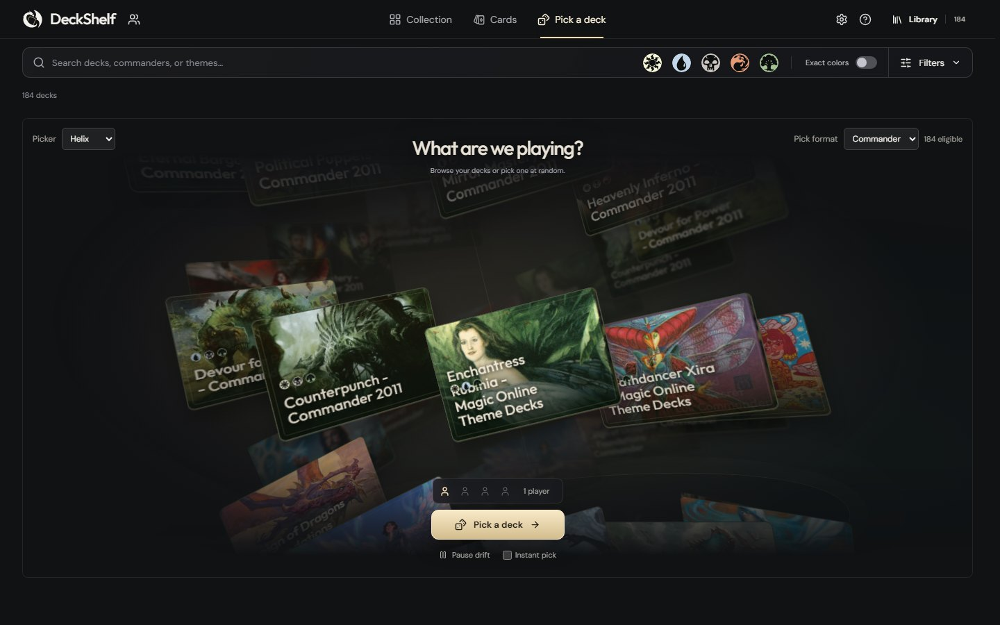
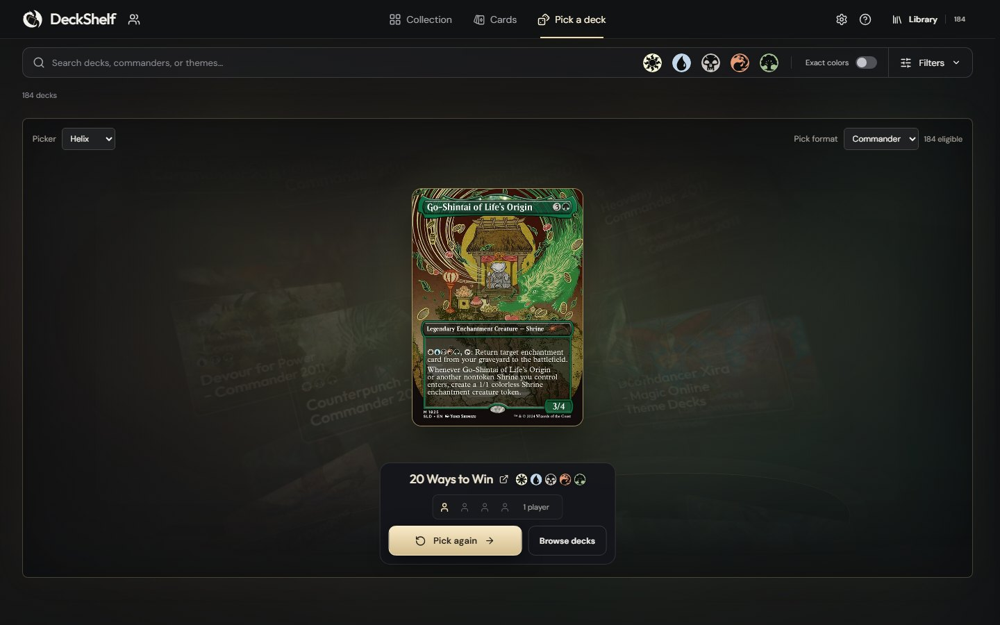

  

DeckShelf shows your Magic: The Gathering decks as a wall of cards. Filter them, then let it pick one at random when the table can't decide what to play. DeckShelf 1.0.0 is the first public release.

## Get it

- **In your browser:** [deckshelf.birckk.com](https://deckshelf.birckk.com). Nothing to install. Your collection is saved in your browser; the server keeps no account or deck database.
- **Windows:** download **DeckShelf-Setup-1.0.0-x64.exe** below and run it. It installs for your user without admin rights and adds a Start menu entry and an uninstaller. Prefer no install? The **windows-x64.zip** is the same app to unzip and run.
- **Docker:** `docker pull ghcr.io/birckk/deckshelf:v1.0.0`. See [hosting](https://github.com/Birckk/DeckShelf/blob/main/docs/HOSTING.md).

The Windows app is **unsigned**, so SmartScreen warns before it runs: choose *More info* → *Run anyway*. `SHA256SUMS.txt` lets you check the download wasn't corrupted.

  
  

## What's in 1.0

- **Archidekt imports.** Link a public Archidekt account, folder or single deck. DeckShelf only reads public data and never asks for a login.
- **The shelf.** Each deck shows as its commander or featured card. Search by name and filter by format, colour identity, set or theme.
- **Starter collection.** The 184 Commander precons are available as an optional collection, so the app works before you link anything.
- **Pickers.** A spinning helix or a shuffle-and-deal, for up to four players at once. Every deck in the pool has the same chance.
- **Friends' collections.** Open a friend's public Archidekt collection by username, read-only beside your own Library. Bookmark it, or share your own shelf as a link.
- **Backups.** Export your collection to a file and restore it in another browser or the Windows app.
- **Offline and phones.** Once loaded, the site works offline, and it can be installed from the browser menu on phones.

## Known limits

- Windows x64 only for the desktop app, with no auto-updater. No macOS or Linux build.
- Imports depend on Archidekt's public endpoints, which may change.
- No sync between devices; use a backup file to move a collection.

[Desktop guide](https://github.com/Birckk/DeckShelf/blob/main/docs/DESKTOP.md) · [What was tested](https://github.com/Birckk/DeckShelf/blob/main/docs/VALIDATION.md) · [Third-party notices](https://github.com/Birckk/DeckShelf/blob/main/docs/THIRD_PARTY_NOTICES.md)

Inspired by [GameShelf](https://gameshelf.io/). Deck data from Archidekt; mana symbols from Scryfall. DeckShelf is unofficial Fan Content permitted under the Fan Content Policy. Not approved/endorsed by Wizards. Portions of the materials used are property of Wizards of the Coast. ©Wizards of the Coast LLC. The source code is MIT licensed.
