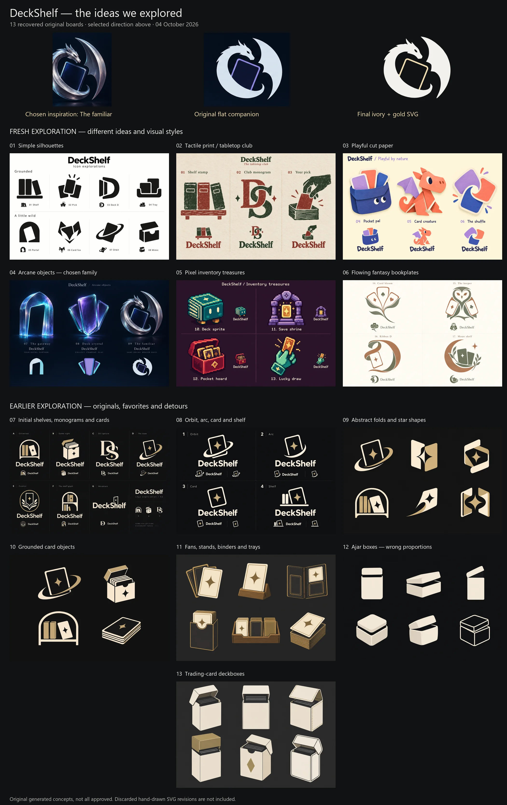
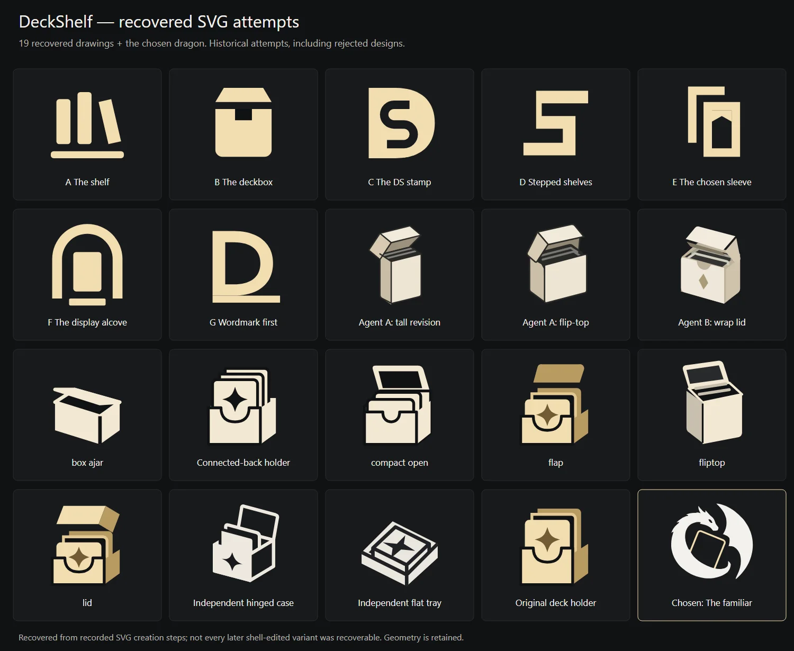

# Logo exploration — 4 October 2026

A compact visual record of the ideas explored before choosing the familiar dragon. Historical concepts, including rejected attempts; the production assets are `public/brand-familiar.svg` and `public/favicon.svg`.

## Generated ideas

All 13 recovered image-generation boards, with the chosen inspiration, flat companion and final logo at the top.

## SVG attempts

19 recovered vector attempts alongside the chosen dragon. Some later minor variants were not recoverable.

[Editable SVG comparison sheet](deckshelf-svg-attempts.svg). These three assets total approximately 484 KB; no old preview sites or tooling are retained.

Selected logo: archive PR 27, [completed discovery #25](https://github.com/Birckk/DeckShelf/issues/25).
